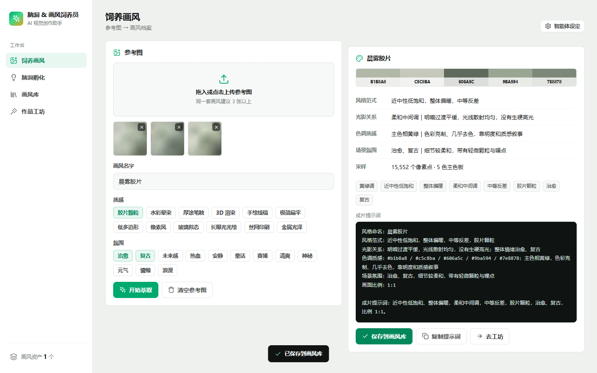
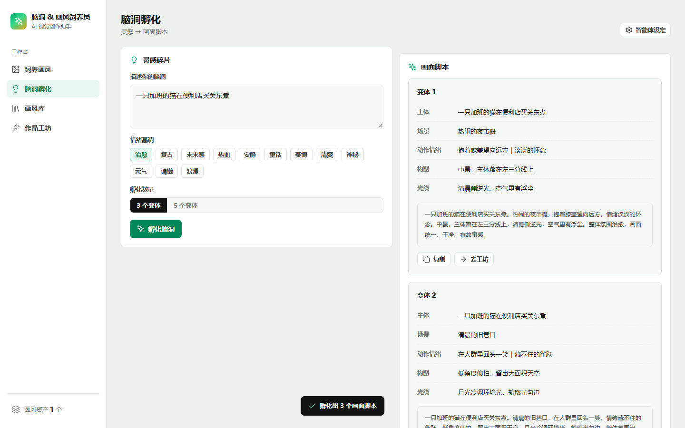
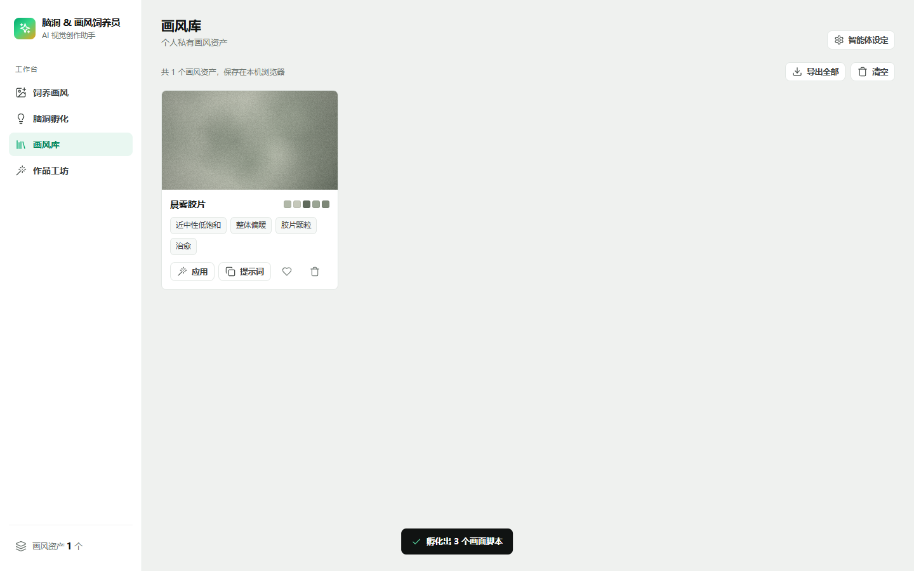
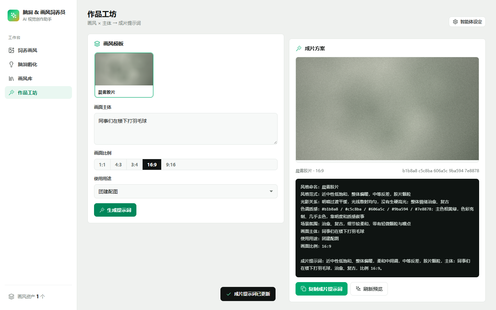
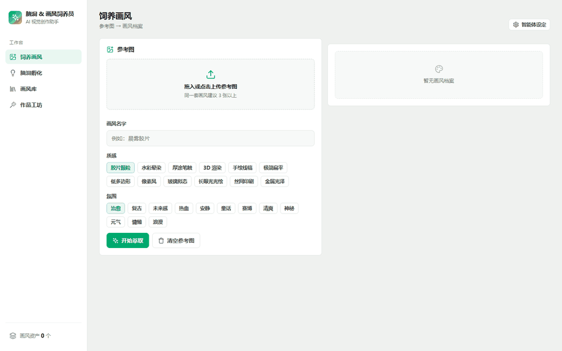

# 脑洞 & 画风饲养员

一个零依赖的浏览器端 AI 视觉创作助手。上传成套参考图后，工具会从像素中萃取出主色板、明暗、饱和、冷暖与反差特征，生成结构化的「画风档案」；再把一句粗糙灵感扩写成可直接使用的成片提示词。

《开源创新思维》作业 2 · 赛道：元气玩咖：AI 生活趣味分享

## 在线演示

- GitHub Pages：https://wishxin.github.io/naodong-huafeng-feeder/
- 本地运行：双击仓库根目录的 `index.html`，无需安装依赖或启动服务

## 功能

| 模块 | 能做什么 |
| --- | --- |
| 饲养画风 | 上传最多 8 张参考图，自动提取 5 色主色板与光影/色调/反差特征，生成画风档案并保存 |
| 脑洞孵化 | 输入一句灵感，输出 3 或 5 个画面脚本，包含主体、场景、动作情绪、构图、光线 |
| 画风库 | 管理个人私有画风资产，支持应用、复制提示词、生成分享卡片、导出 JSON |
| 作品工坊 | 画风 × 主体 × 比例组合，产出成片提示词，并用画风色板实时绘制预览画布 |

## 界面

| 饲养画风 | 脑洞孵化 |
| --- | --- |
|  |  |

| 画风库 | 作品工坊 |
| --- | --- |
|  |  |

## 演示



## 技术要点

- **零运行时依赖**：单个 `index.html`，HTML + CSS + 原生 JavaScript，无构建步骤。
- **真实色彩分析**：把参考图缩放到 72×72，读取像素后在 Lab 之外的 RGB 空间做 5 类 k-means 聚类，得到主色板与采样统计。
- **可解释的描述器**：用平均明度、平均饱和度、冷暖像素占比、亮度标准差四组指标映射到中文的「光影关系 / 色调质感 / 反差 / 氛围」。
- **本地优先**：画风资产存于 `localStorage`，不上传服务器；分享通过复制文本完成。
- **响应式**：桌面侧栏、移动端横向标签栏两套布局，390 / 820 / 1440 三档实测无横向溢出。
- **离线可用**：不引用任何 CDN、字体或远程图片。

## 目录结构

```
.
├── index.html                      # 应用入口，单文件实现
├── README.md
├── LICENSE
├── SHA256SUMS.txt
├── docs/
│   ├── 01-项目说明.md
│   ├── 02-产品设计.md
│   ├── 03-技术方案.md
│   ├── 04-测试记录.md
│   └── 05-开源合规说明.md
├── agent/
│   └── 脑洞画风饲养员-智能体设定.md
├── evidence/
│   ├── screenshots/                # 界面截图
│   ├── demo.gif                    # 操作演示
│   ├── test-log.md                 # 测试记录
│   └── commit-log.md               # 提交记录
├── report/
│   └── 大数据250164-f25016436-徐郭源-作业2.docx
└── third-party/
    └── NOTICE.md                   # 第三方组件与许可证声明
```

## 设计说明

产品把「养画风」拆成三个可验证的动作：萃取、沉淀、复用。萃取阶段只做可解释的像素统计，不假装拥有生成模型；沉淀阶段把结果结构化为画风档案；复用阶段把档案组装成符合「风格 + 主体 + 场景 + 动作/情绪 + 构图 + 光线 + 画质 + 尺寸」的提示词。

完整的设计与实现说明见 [docs/01-项目说明.md](docs/01-项目说明.md)、[docs/02-产品设计.md](docs/02-产品设计.md)、[docs/03-技术方案.md](docs/03-技术方案.md)。

## 测试

功能、兼容性与布局测试记录见 [docs/04-测试记录.md](docs/04-测试记录.md) 和 [evidence/test-log.md](evidence/test-log.md)。核心结论：

- 上传 3 张参考图后可稳定生成 5 色板与完整档案，采样 15,552 像素。
- 保存后刷新页面，画风资产仍可从 `localStorage` 读取。
- 桌面 1440、平板 820、手机 390 三档无横向溢出、无文字截断。
- 全流程无 JavaScript 控制台报错。

## 开源与许可

- 本项目代码以 [MIT License](LICENSE) 开源。
- 界面图标路径来自 [Lucide](https://lucide.dev/)，遵循 ISC License，完整声明见 [third-party/NOTICE.md](third-party/NOTICE.md)。
- 项目无第三方运行时依赖，不包含需要分发许可证文本的打包组件。

## 作者

- 徐郭源 · 大数据250164 · f25016436
- 指导教师：祝欣蓉
- 课程：《开源创新思维》，2026-2027 秋季学期
